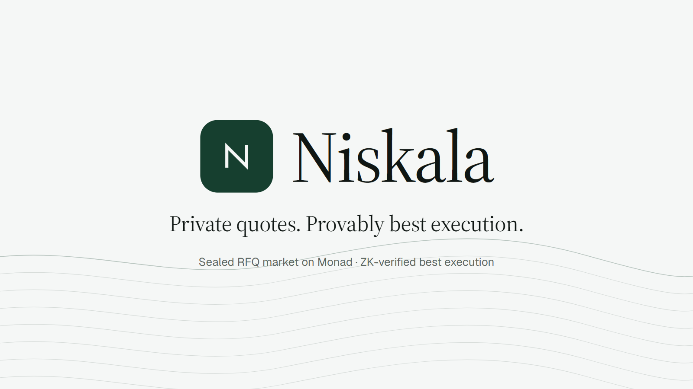
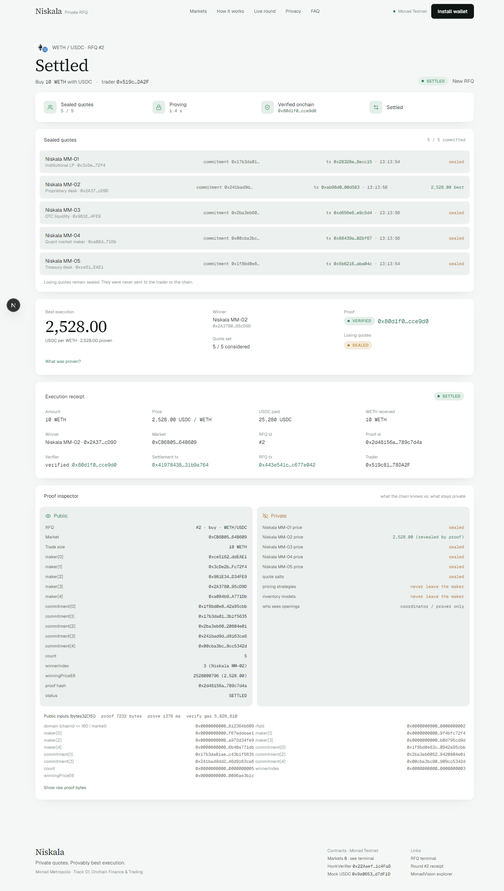
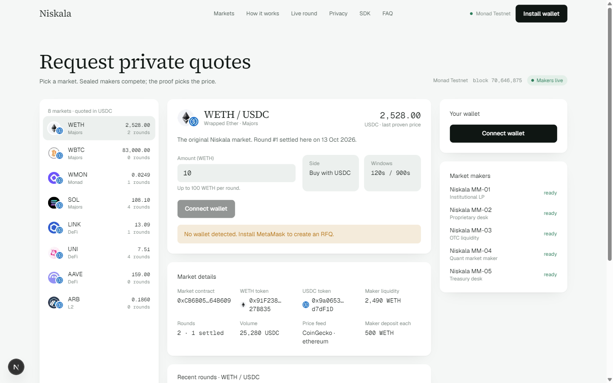

<p align="center">
  
</p>

<p align="center">
  <a href="https://niskala-nu.vercel.app"></a>
  <a href="https://testnet.monadvision.com/address/0x22Aaeff3Df06535AeFD92D5475628D2eF61c4FaD"></a>
  
  
  
</p>

<p align="center">
  <a href="https://niskala-nu.vercel.app">Live app</a> ·
  <a href="https://niskala-nu.vercel.app/rfq/weth-usdc/2">A settled round</a> ·
  <a href="docs/DEMO.md">90-second demo script</a> ·
  <a href="packages/sdk/README.md">SDK</a> ·
  <a href="docs/ARCHITECTURE.md">Architecture</a> ·
  <a href="docs/THREAT_MODEL.md">Threat model</a>
</p>

**Monad Metropolis · Track 01 — Onchain Finance & Trading**

Niskala is a sealed request-for-quote market on Monad. Up to five market makers compete for a fixed-size trade
without publishing their prices. A zero-knowledge proof, verified by the market contract itself, shows that the
selected quote is the best valid quote across the complete committed set. Only the winning price is revealed, and
settlement happens in the same transaction that would otherwise need a trusted router.

> Existing RFQ: private quotes, trusted routing.
> Niskala: private quotes, **verifiable** routing.

---

## The problem

Professional RFQ venues already keep maker pricing private. The trust gap is in routing: the trader takes the
router's word that the quote it picked was the best one in the competition it ran. The two known fixes both
fail someone. A transparent auction fixes routing but publishes every losing price, so makers leak their book over
time. A private router protects makers but asks the trader to trust it.

## The solution

Make the competition sealed and the result provable.

| Move | Who | What goes onchain | What stays private |
|---|---|---|---|
| **1. Request** | trader | pair, size, direction, windows | — |
| **2. Seal** | up to 5 makers, own wallets | `Poseidon2(domain, rfqId, maker, priceE6, salt)`; full size locked in the maker vault | price, salt |
| **3. Close** | contract | window closes at 5 commitments, or at the deadline with ≥ 3 | — |
| **4. Prove** | prover → `HonkVerifier` | winner index, winning price, 7.2 KB UltraHonk proof | every losing price |
| **5. Settle** | trader | USDC to the winner, asset to the trader, losers unlocked, one tx | — |

The proof states, over the exact set of commitments the contract stored: every opening hashes to its commitment,
every price is positive, the winning price is ≤ every committed price (first minimum wins ties), and the winning
price is the winner's own. The contract rebuilds the public inputs from its own storage, so a proof is bound to one
chain, one market, one RFQ and one commitment set. Replaying it anywhere else fails.

## What makes it useful

- **Traders** get firm, competitive execution plus evidence the router did not play favourites. The receipt links
  every transaction and the proof.
- **Makers** compete without putting losing prices on a public book. Strategy and inventory never leave the maker.
- **Builders** get `@niskala/sdk`: the same client the terminal runs on, with trader, maker, reader and prover
  surfaces over Web3.js.

## A real round on Monad

WETH/USDC round #2, five makers, as it ran on testnet. Every row is a transaction you can open.

| Step | Transaction |
|---|---|
| RFQ opened (buy 10 WETH) | [`0x443e541c…`](https://testnet.monadvision.com/tx/0x443e541c09da34a71c1c828a83b9b8e3649e53c3032dac79921bafa7c677e042) |
| 5 sealed commitments | [`0x5b6216bc…`](https://testnet.monadvision.com/tx/0x5b6216bcc7980cbd3d8499137f8b761b32de876fa1d1152629847f5a6daba04c) [`0x28328ee2…`](https://testnet.monadvision.com/tx/0x28328ee23dcd70d6fb7a165742425bff818be32bf8429986bf2342103d8ecc15) [`0x88439ad4…`](https://testnet.monadvision.com/tx/0x88439ad436d4821f61783e3d470ace348bbce321902d176c9509f3969f02bf67) [`0xd656e6b8…`](https://testnet.monadvision.com/tx/0xd656e6b85f1afac453c60a8282aa17b1e9f0a9c9d2eea927349d15f198e9c5d4) [`0xab98d0f8…`](https://testnet.monadvision.com/tx/0xab98d0f8f8d9196db062ea0863c82b00e1d3aee01786fa92a044fd9b9200d583) |
| Proof verified onchain (5.83 M gas) | [`0x80d1f0d4…`](https://testnet.monadvision.com/tx/0x80d1f0d473fa286aa956dae2eba8c83f5e8fe60a09f8a539bdbd36754dcce9d0) |
| Settled at 2,528.00 USDC per WETH | [`0x41978438…`](https://testnet.monadvision.com/tx/0x419784383ed2c25ff844d67e45274416c8f892b8745dbb4315b0886c31b9a764) |

Full receipt and proof inspector: https://niskala-nu.vercel.app/rfq/weth-usdc/2

<p align="center">
  
</p>

## Numbers

| Metric | Value |
|---|---|
| Round on Monad | create → 5 commits (≈ 1.6 s) → proof verified (≈ 5 s) → execute (≈ 7 s) |
| Proof | 7,232 bytes + 15 public inputs, UltraHonk (keccak), proved in 0.5–1.4 s with bb.js WASM |
| Onchain verification | ≈ 5.8 M gas on Monad testnet (≈ 0.65 MON at 102 gwei) |
| Markets | 8 (WETH, WBTC, WMON, SOL, LINK, UNI, AAVE, ARB vs USDC), 5 makers per round |
| Contracts | 27 deployed, 27 Sourcify-verified on MonadVision |
| Tests | 26 Foundry tests with real proofs · 5 circuit tests · 7 SDK tests |

## How it is built

```
┌──────────────┐  @niskala/sdk (Web3.js)  ┌────────────────────────────┐
│  apps/web    │ ────────────────────────▶│  RfqMarket.sol × 8 (Monad)  │
│  Next.js 16  │  createRfq / execute     │  · rounds + commitments     │
│              │◀───── reads ─────────────│  · maker vault per market   │
└──────┬───────┘                          │  · submitProof → verifier   │
       │ REST                             │  · atomic settlement        │
       ▼                                  └──────────┬─────────────────┘
┌──────────────────────────────────────┐             │ verify(proof, bytes32[15])
│  apps/coordinator (Node, Railway)    │             ▼
│  · 5 demo makers, private strategies │   ┌────────────────────┐
│  · prover: Noir + bb.js UltraHonk    │   │ HonkVerifier.sol   │ generated by bb.js
│  · relayer, deadline housekeeping    │   └────────────────────┘
│  · signed opening intake (SDK makers)│
└──────────────────────────────────────┘
```

| Layer | Implementation |
|---|---|
| Circuit | Noir 1.0.0-rc.3, `circuits/best_quote`, Poseidon2 commitments, 5 slots + public `count` |
| Proving | `@aztec/bb.js` UltraHonk (EVM/keccak target) through `@noir-lang/noir_wasm`; no native binaries |
| Contracts | Foundry: `RfqMarket.sol`, generated `HonkVerifier.sol`, `MockERC20.sol`; 26 tests with real proof fixtures |
| Coordinator | Node 24, Web3.js v4, multi-endpoint RPC routing with per-endpoint rate limits, batched reads, local nonces |
| History | Envio HyperSync: every market event across all eight markets in one paginated query, plus the `submitProof` calldata and block times, folded into round records (commit txs, proof bytes and gas, settlement). A fresh host rebuilds the full history in seconds; no 100-block `eth_getLogs` windows |
| Web | Next.js 16, Tailwind 4, Web3.js v4 isolated in the SDK, three.js hero, Playwright-driven wallet e2e |
| SDK | `@niskala/sdk`: trader, reader, maker (`/maker`), prover (`/prover`) |

<p align="center">
  
</p>

## Honest privacy boundary

Losing prices and salts never reach the trader, the frontend or the chain. The coordinator that builds the witness
**does** see the openings. Privacy against the prover (MPC / FHE / TEE proving) is roadmap, not a claim.

| Data | Visibility |
|---|---|
| RFQ pair, size, direction, committed makers, commitment hashes | Public |
| Winning price, winner, proof, verifier result, settlement | Public after the proof |
| Losing prices, salts | Private from trader and chain (known to the prover) |
| Maker pricing strategy, inventory | Private, never leave the maker |

Full table of threats and gaps: [`docs/THREAT_MODEL.md`](docs/THREAT_MODEL.md).

## Deployed contracts (Monad testnet, chainId 10143)

One `HonkVerifier` ([`0x22Aaeff3…`](https://testnet.monadvision.com/address/0x22Aaeff3Df06535AeFD92D5475628D2eF61c4FaD)),
one mock USDC ([`0x9a0653C6…`](https://testnet.monadvision.com/address/0x9a0653C6a22318dE8e89e696422eFD9fE7d7dF1D)),
eight markets. All Sourcify-verified. Registry: [`packages/pools/pools.json`](packages/pools/pools.json).

| Market | Tier | Base token | RfqMarket | Maker deposit | Default / max size |
|---|---|---|---|---|---|
| WETH / USDC | Majors | [`0x91F2388e…`](https://testnet.monadvision.com/address/0x91F2388e78906ef91fB7E673A45d21852027B835) | [`0xCB6B0505…`](https://testnet.monadvision.com/address/0xCB6B05059d5Fe13866612Ff1c391Aa812364B609) | 500 WETH | 10 / 100 |
| WBTC / USDC | Majors | [`0x12e36137…`](https://testnet.monadvision.com/address/0x12e36137B87431e23429B112Cbd51e7a680196DD) | [`0xB29AF2bD…`](https://testnet.monadvision.com/address/0xB29AF2bD7e086B0347434B5888eB42bF7BA83AeC) | 25 WBTC | 0.5 / 5 |
| WMON / USDC | Monad | [`0xE2958467…`](https://testnet.monadvision.com/address/0xE29584674c46f492663424c5848aAA5C550C9116) | [`0xAa6942Fd…`](https://testnet.monadvision.com/address/0xAa6942Fdf7C2658a662fA48cBb1aD10d5ca9FBD2) | 500,000 WMON | 10,000 / 100,000 |
| SOL / USDC | Majors | [`0x0b7eA661…`](https://testnet.monadvision.com/address/0x0b7eA6619842625BD56e8Bcf50cEAefF6d935F76) | [`0x49294a48…`](https://testnet.monadvision.com/address/0x49294a487b54Ebe500e1696F535F31267f6e290e) | 5,000 SOL | 100 / 1,000 |
| LINK / USDC | DeFi | [`0x3eef804e…`](https://testnet.monadvision.com/address/0x3eef804e7E7f55E972A1E4D8c4ccFC5779db6f23) | [`0x1c65C0Bf…`](https://testnet.monadvision.com/address/0x1c65C0Bf82A25e037e6A04739fB6c3F5A161Fdba) | 25,000 LINK | 500 / 5,000 |
| UNI / USDC | DeFi | [`0xf9E94B9C…`](https://testnet.monadvision.com/address/0xf9E94B9CD4eD5Ac8F398cCCB4dCDB07F66A0D913) | [`0x2710E1f1…`](https://testnet.monadvision.com/address/0x2710E1f1954fba536E75B5C9d28A9bc809FF7290) | 50,000 UNI | 1,000 / 10,000 |
| AAVE / USDC | DeFi | [`0xC1D4B776…`](https://testnet.monadvision.com/address/0xC1D4B77612310a0879EF2459B7231604C546FAB0) | [`0xBd4C2923…`](https://testnet.monadvision.com/address/0xBd4C2923A62e039C735aF64219ec81994027A75c) | 2,500 AAVE | 50 / 500 |
| ARB / USDC | L2 | [`0x8739f97b…`](https://testnet.monadvision.com/address/0x8739f97b5e575329dEEB3294675c6adAc72B8d60) | [`0x7AED9229…`](https://testnet.monadvision.com/address/0x7AED92298E3294114B2D4497e5Dcb68eCBc329C6) | 250,000 ARB | 5,000 / 50,000 |

Base tokens are 18-decimal mocks with an open `mint`. Prices are USDC per unit with 6 decimals (`priceE6`). The v1
deployment (three fixed slots, market [`0x054694A7…`](https://testnet.monadvision.com/address/0x054694A70B61AA6493A14ea729f7044986A30F9D),
verifier [`0x4978Ca3B…`](https://testnet.monadvision.com/address/0x4978Ca3B939D93e0611Bc317aD0e923D0FEA6354)) stays onchain and holds round #1.

## Try it (judges)

1. Open https://niskala-nu.vercel.app and read the landing page: the live round section replays round #2 with its transactions.
2. Open the terminal, connect MetaMask. Monad Testnet is added automatically. Gas needs a little testnet MON: paste your address at https://faucet.monad.xyz.
3. Click **Mint 100,000 test USDC**, pick a market, **Request private quotes**. Five commitments land in about two seconds, the proof is verified onchain a few seconds later, the page scrolls to **Execute**.
4. Execute. The receipt links the settlement transaction and the proof inspector shows what is public versus private.
5. Verify any contract on MonadVision, or run the whole loop from a script:

```bash
pnpm install && pnpm lifecycle:monad   # TRADER_KEY in apps/coordinator/.env, prints explorer links
```

## SDK

```ts
import { Niskala } from "@niskala/sdk";

const niskala = new Niskala({ provider: window.ethereum });
const { rfqId } = await niskala.createRfq("weth-usdc", amount, { from });
const proven = await niskala.waitForProof("weth-usdc", rfqId);
await niskala.executeRfq("weth-usdc", rfqId, { from });
```

Makers use `@niskala/sdk/maker`: `MakerClient.quote()` seals a Poseidon2 commitment, sends the commit transaction
from the maker wallet and hands the signed opening to the prover. External makers can join any market today.
Guide and runnable examples: [`packages/sdk/README.md`](packages/sdk/README.md).

## Run it yourself

Prerequisites: Node ≥ 22, pnpm 11, Foundry. No native `nargo`/`bb`.

```bash
pnpm install
pnpm check            # circuit tests, sdk tests, forge tests with real proofs, typecheck, web build
pnpm dev              # coordinator on :8787 + web on :3000 (needs apps/coordinator/.env, see .env.example)
```

Deploy your own markets with `pnpm deploy:pools`, fund makers with `pnpm setup:monad`, host with
[`docs/DEPLOY.md`](docs/DEPLOY.md) (Railway for the coordinator, Vercel for the web app). Local anvil rehearsal is in
[`docs/ARCHITECTURE.md`](docs/ARCHITECTURE.md).

## Repository

```
apps/web            Next.js 16 landing, RFQ terminal, round page, proof inspector
apps/coordinator    demo makers, prover, relayer, REST API + signed opening intake, Dockerfile
packages/sdk        @niskala/sdk
packages/zk         noir_wasm compile · bb.js Poseidon2 + UltraHonk · fixture generators
packages/abi        ABIs exported from Foundry
packages/pools      deployment registry per chain
circuits/best_quote Noir circuit (+ vendored noir-lang/poseidon)
contracts           Foundry: RfqMarket.sol, HonkVerifier.sol (generated), MockERC20.sol, scripts, tests
docs                ARCHITECTURE · DEMO · DEPLOY · THREAT_MODEL · SUBMISSION · brand · screenshots
STATE.md · RESEARCH.md · DECISIONS.md   build log, prior-art audit, 32 recorded decisions
```

## Roadmap

- Privacy against the prover: MPC or TEE witness generation, then FHE.
- Arbitrary-size completeness: Merkle root of the eligible maker set as the public input.
- Maker accountability: delivery receipts, bonds and slashing for withheld openings.
- Both sides and partial fills; real tokens on Monad mainnet.

## Scope and limitations

Up to five maker slots per round; buy side; full fills; mock tokens on testnet; five demo makers run inside one
coordinator process (own wallets, private strategies). Everything in this repository was built during the Metropolis
window (first commit 2026-10-13, see `git log`).

## License

MIT for Niskala code. `circuits/poseidon` is noir-lang/poseidon (MIT), vendored unchanged.
