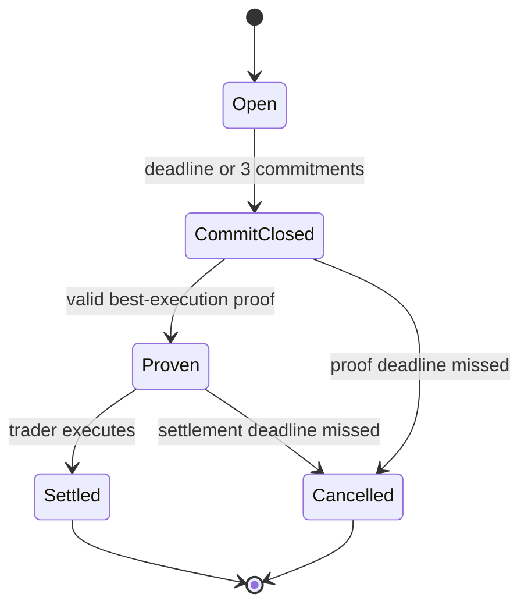
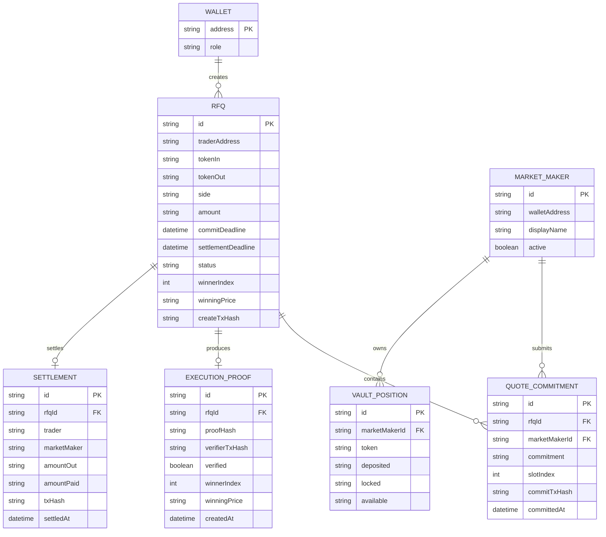

# NISKALA MARKETS — MASTER BUILD PACK
## Monad Metropolis — Track 01: Onchain Finance & Trading

**Working product name:** Niskala Markets  
**Short name:** NISKALA  
**One-line pitch:** **Private quotes. Provably best execution.**  
**Core product:** Sealed RFQ market making with ZK-verifiable best execution on Monad.  
**Hackathon track:** 01 — Onchain Finance & Trading  
**Primary user:** Trader / professional liquidity taker  
**Supply-side user:** Professional market maker / RFQ liquidity provider  
**Core proof:** The selected winning quote is the best valid quote among the complete eligible quote set, while losing prices remain hidden from the public and trader.

> **Important product boundary:** Niskala is not “private Uniswap,” not a generic dark pool, and not a ZK wrapper around an RFQ aggregator. The product is a **private RFQ competition whose result can be verified without trusting the router**.

---

# 0. FABLE OPERATING MODE — READ THIS FIRST

You are operating autonomously on a time-critical hackathon build. The user is not watching in real time and should not be asked routine questions mid-run.

## Working discipline

1. **Explore before changing.** Read the repo and existing files before writing.
2. **Maintain `STATE.md`.** It must always contain:
   - current goal;
   - current architecture;
   - completed tasks;
   - next tasks;
   - blockers;
   - assumptions;
   - decisions and why they were made.
3. **Never claim something works without running a check that would fail if it did not work.**
4. **Do not repeatedly retry the same failing approach.** After two failures on the same subproblem, change hypothesis or simplify scope.
5. **Optimize for a complete end-to-end demo before polish.**
6. **Do not stop after describing the next step. Execute it.**
7. **Do not fake cryptography, transactions, proofs, or market-maker behavior.**
8. If a production-grade design is too large for the remaining time, implement the smallest honest version and document the production upgrade path.
9. Preserve the core product positioning as **private market making / RFQ**, not generic identity or ZK infrastructure.
10. Before finalizing, run a fresh self-review focused on:
    - broken demo paths;
    - overclaims;
    - security assumptions;
    - stale or hardcoded Monad network information;
    - whether the ZK statement actually proves what the UI says it proves.

## Definition of “done”

The task is not done until a judge can:

1. open the app;
2. connect a wallet;
3. create an RFQ for a fixed-size trade;
4. see at least 3 market makers submit sealed commitments;
5. see the RFQ round close;
6. see a real ZK proof generated from private quote values;
7. see the proof verified;
8. see the best quote selected;
9. settle the trade on Monad using mock assets;
10. inspect a proof/execution screen showing what was public, what stayed private, and the onchain transaction.

If a step cannot be completed, document it honestly in `STATE.md` and the README and prioritize fixing it before aesthetic work.

---

# 1. PRODUCT THESIS

## Current RFQ market structure

Professional RFQ flow is broadly:

```text
Trader
  |
  | "Buy 10 ETH"
  v
RFQ Router / Aggregator
  |
  +----> MM A -> quote
  +----> MM B -> quote
  +----> MM C -> quote
  |
  v
Router selects a quote
  |
  v
Trader executes
```

The market makers can keep their inventory, hedging logic, and pricing strategy private. That privacy already exists in professional RFQ markets.

The trust gap is elsewhere:

> The trader typically relies on the router to tell them that the route or quote selected was actually the best valid execution from the competition the router observed.

## Niskala changes the trust model

```text
Trader creates RFQ
      |
      v
Onchain RFQ round on Monad
      |
      +---- MM A submits sealed commitment
      +---- MM B submits sealed commitment
      +---- MM C submits sealed commitment
      |
      v
Commit window closes
      |
      v
Private quote preimages reach prover
      |
      v
ZK proof:
- every quote matches its commitment
- every quote satisfies the RFQ constraints
- winner is the best price
- proof is bound to the eligible quote set
      |
      v
Monad verifier
      |
      v
Winner + price + proof
      |
      v
Atomic settlement
```

## Core statement

**Existing RFQ:** private quotes + trusted routing.  
**Niskala:** private quotes + verifiable routing.

## Why the product exists

Open markets create a tension:

- Traders want competitive execution and evidence that routing was fair.
- Market makers do not want losing quotes and pricing behavior broadcast publicly.
- A fully transparent auction gives verifiability but leaks information.
- A fully private router protects information but requires trust.

Niskala aims at the middle:

> **Private competition for market makers, verifiable execution for traders.**

---

# 2. NAMING & BRAND

## Recommended name: Niskala Markets

**Why it fits**

“Niskala” is used in Indonesian cultural vocabulary for the unseen / non-visible realm. It maps naturally to a venue where competition exists and can be proven even though losing quotes are not publicly visible.

The brand should feel:
- institutional;
- quiet;
- precise;
- cryptographic;
- private without looking illicit;
- professional rather than “cyberpunk.”

**Product display name:** `Niskala Markets`  
**Protocol / repo name:** `niskala`  
**App title:** `Niskala — Private RFQ`  
**Tagline:** `Private quotes. Provably best execution.`

## Strong alternatives

- **Senyap Markets** — “silent”; strong privacy meaning, slightly less international.
- **Samar Markets** — “obscured / faint”; memorable but can imply uncertainty.
- **Bayang Markets** — “shadow”; visually strong but “shadow market” can sound illicit.
- **Sandi Markets** — “cipher/code”; good crypto association but also a common personal name.

**Default decision:** use **Niskala Markets** unless a trademark/domain check produces a blocker.

---

# 3. HACKATHON FIT

## Primary track

**Monad Metropolis — Track 01: Onchain Finance & Trading**

The official track explicitly includes trading and market-making products and emphasizes that fast settlement makes new onchain markets more practical.

## Why Monad matters

Do not pitch Monad as “just where contracts are deployed.”

The product needs a chain that can make this loop feel close to a professional market:

```text
RFQ creation
-> market maker commitments
-> close
-> proof verification
-> execution
-> settlement
```

Monad should be used for:
- RFQ round state;
- sealed commitment registry;
- eligibility/bond state;
- verifier call;
- winner state;
- atomic token settlement;
- execution history.

## Sponsor integrations

**Do not add sponsor integrations until the core demo is end-to-end.**

Optional, only after core completion:
- **Envio:** index RFQ, commitment, proof, and settlement events for history/analytics.
- **Kuru:** only if a genuinely useful post-RFQ routing or hedging integration emerges. Do not distort Niskala into a Kuru frontend.
- Other sponsor integrations: skip unless they improve the core experience.

---

# 4. NOVELTY BOUNDARY / PRIOR-ART TEST

Before coding deeply, audit the closest prior art and record the result in `RESEARCH.md`.

At minimum compare Niskala against:
- professional RFQ routing such as 0x / Hashflow-style systems;
- confidential / encrypted RFQ systems;
- sealed-bid auctions;
- private order books;
- ZK best-execution prototypes;
- ZK proprietary-strategy / market-maker systems;
- known hackathon projects including Waiola, Red Black Honey Girl, ZkAlpha, P.A.T, and any newer direct analogue.

## Niskala is **not sufficiently novel** if a current product already implements all of:

1. market makers submit hidden quotes for an RFQ;
2. the quote competition is bound to an onchain set of eligible submissions;
3. a cryptographic proof shows the selected quote is the best valid quote in that complete eligible set;
4. losing quotes remain non-public;
5. the winner can settle atomically onchain.

If a direct equivalent is found, **do not abandon private market making immediately**. First explore a meaningful refinement inside the same product category, for example:
- proof of completeness / anti-censorship of submitted commitments;
- verifiable quote-policy compliance for delegated LP capital;
- proof of mandate compliance for professional market makers;
- private market-making capital pools with provable risk constraints;
- cross-venue private RFQ competition.

Do not reposition as generic Trust/Identity infrastructure unless explicitly instructed by the user.

---

# 5. MVP PRODUCT SCOPE

## The MVP intentionally supports one simple market

Use a fixed-size RFQ for:

```text
Trader buys WETH
Trader pays MockUSDC
```

Example:

```text
BUY 10 WETH
```

Three market makers compete.

All market makers must commit to fill the **entire requested amount**. This deliberately removes partial-fill optimization from the MVP.

## What is private

For the MVP:

| Data | Public / Private |
|---|---|
| RFQ pair | Public |
| RFQ requested amount | Public |
| RFQ direction | Public |
| Market makers participating | Public |
| Quote commitments | Public |
| Losing prices | Private from trader/public/onchain |
| Winning price | Public after proof |
| Market-maker pricing strategy | Private |
| Market-maker inventory model | Private |
| Market-maker quote salt | Private except winner if implementation requires reveal |
| ZK proof | Public |
| Settlement transaction | Public |

### Important privacy honesty

In the simplest MVP, a **coordinator/prover may see quote preimages** in order to generate the aggregate proof.

Therefore do **not** claim:
- “nobody sees losing quotes”;
- “trustless confidentiality against the prover”;
- “fully private market making.”

Claim:

> Losing quotes are not revealed to the trader or public chain, and the winner selection can be verified cryptographically.

Production roadmap:
- MPC/FHE/TEE/distributed proving to remove or reduce trust in the quote coordinator.

---

# 6. USER PERSONAS

## Trader / Liquidity Taker

Needs:
- firm execution;
- competitive pricing;
- no uncertainty about whether router preferences affected winner selection;
- fast settlement.

Does not need to learn ZK internals.

## Market Maker

Needs:
- compete without putting losing prices on a public order book;
- simple commitment flow;
- predictable settlement;
- capital returned immediately when losing;
- no need to expose strategy or inventory.

## Judge / Protocol Observer

Needs:
- understand in <30 seconds why this is different;
- inspect the commitment set;
- inspect proof status;
- verify actual Monad transactions.

---

# 7. CORE USER JOURNEY

## Trader flow

1. Connect wallet.
2. Open `Trade`.
3. Select `WETH / USDC`.
4. Enter `10 WETH`.
5. Click `Request Private Quotes`.
6. RFQ transaction creates an onchain round.
7. UI shows:
   - round ID;
   - commit countdown;
   - market makers participating;
   - quotes as `SEALED`.
8. Three MMs commit.
9. Commit window closes.
10. Proof generation begins.
11. UI displays:
    - `Best price proven`;
    - winning MM;
    - winning price;
    - `3/3 eligible quotes considered`;
    - losing quotes remain sealed.
12. Trader clicks `Execute`.
13. Settlement transaction sends WETH to trader and USDC to winning MM.
14. Execution receipt page shows proof + tx.

## Market-maker flow

MVP MMs can be simulated services, but build the UI/data model as if they were independent participants.

Each MM:
1. monitors RFQs;
2. calculates a private price using its own strategy;
3. creates a commitment from quote + salt;
4. submits commitment onchain;
5. reserves required WETH for the round;
6. privately sends quote preimage to prover;
7. waits for result;
8. winner settles; losers unlock capital.

---

# 8. PRD

## Goal

Build a working private RFQ venue on Monad where the best price among three sealed market-maker quotes can be proven with ZK and settled onchain.

## Non-goals for hackathon MVP

Do not build:
- a generalized AMM;
- a full central-limit order book;
- partial fills;
- cross-chain settlement;
- multiple quote currencies;
- dynamic inventory hedging;
- production-grade MM onboarding;
- FHE/MPC privacy;
- leveraged trading;
- perps;
- liquidation engines;
- complex order types.

## Functional requirements

### RFQ creation

Trader can create RFQ with:
- token in;
- token out;
- requested amount;
- direction;
- commit deadline;
- proof/settlement deadline.

Acceptance:
- RFQ exists on Monad;
- unique `rfqId`;
- event emitted;
- UI updates from chain state.

### Quote commitment

Exactly 3 demo MMs can submit:
- commitment hash;
- required collateral/locked asset.

Acceptance:
- each MM can commit once;
- commitment is immutable after close;
- MM must have sufficient locked asset;
- UI never displays plaintext losing price.

### ZK proof

A real circuit must prove at minimum:
- each private quote opening corresponds to a public commitment;
- all considered quotes are for the RFQ;
- winner is minimum price for a trader BUY;
- winner index and winning price match the proof output.

Acceptance:
- modifying any private quote breaks verification;
- changing winner breaks verification;
- changing a public commitment breaks verification.

### Proof verification

Acceptance:
- proof is verified by a generated verifier contract or an equivalently real onchain verifier;
- verifier result is part of the round state;
- UI reads verification status from chain.

### Settlement

Acceptance:
- only proven winner can settle;
- winning MM delivers requested WETH;
- trader pays exact winning price in MockUSDC;
- losing MM locked assets are released;
- double execution fails.

---

# 9. ZK DESIGN

## Recommended stack

Use **Noir + Barretenberg** unless current tooling prevents reliable Solidity verifier generation.

Why:
- readable circuit code;
- fast hackathon development;
- strong EVM verification workflow;
- TypeScript-friendly proving ecosystem.

Fable must verify the current Noir/Barretenberg commands and APIs rather than relying on stale syntax.

## MVP proof statement

For exactly 3 market makers:

### Public inputs

Conceptually:

```text
rfqId
requestedAmount
side                  // BUY
commitmentA
commitmentB
commitmentC
winnerIndex
winningPrice
roundDomainSeparator
```

### Private witnesses

```text
priceA
saltA

priceB
saltB

priceC
saltC
```

If the circuit commitment includes MM identity:

```text
mmA / mmB / mmC identifiers
```

may be public or bound via a round-domain hash.

### Constraints

For each quote:

```text
hash(rfqId, mmId, price, salt, domain) == publicCommitment
```

Then for BUY:

```text
winningPrice == price[winnerIndex]

winningPrice <= priceA
winningPrice <= priceB
winningPrice <= priceC
```

Require price > 0 and bounded to a sane integer range.

Use integer fixed-point pricing. Example:
- USDC decimals = 6;
- quote price represented as `priceE6`.

No floats.

## Commitment hash

Prefer a hash that is easy and safe to reproduce inside the selected ZK stack.

Do not choose a hash based on familiarity alone. Verify:
- circuit implementation exists;
- JavaScript/TypeScript implementation exists;
- field serialization is consistent.

The Solidity contract does not need to recompute all private quote hashes if the verifier proof already binds public commitments to private openings.

## Completeness in MVP

The MVP uses exactly 3 known demo MM slots, and the circuit takes all 3 public commitments.

Therefore the proof is explicitly about:

> **the full set of the 3 commitments recorded for this RFQ.**

Do not claim scalable arbitrary-size completeness from this fixed circuit.

## Production path

Replace fixed public commitments with:
- a Merkle root / vector commitment of the eligible quote set;
- variable/batched proof architecture;
- delivery receipts and slashing for committed MMs who fail to provide a quote opening to the prover;
- optional distributed/FHE/MPC proving.

---

# 10. SMART CONTRACT ARCHITECTURE

Recommended contracts:

```text
RfqMarket.sol
ProofVerifier.sol       // generated / wrapper
SettlementVault.sol
MockUSDC.sol
MockWETH.sol
```

## `RfqMarket.sol`

Responsibilities:
- create RFQ;
- register market makers;
- accept commitment;
- manage round state;
- close commit window;
- store commitments in deterministic slot order;
- receive proof result;
- bind proof to exact RFQ;
- record winner;
- trigger settlement.

Suggested state:

```solidity
enum RfqStatus {
    OPEN,
    COMMIT_CLOSED,
    PROVEN,
    SETTLED,
    CANCELLED
}
```

Conceptual struct:

```solidity
struct RFQ {
    address trader;
    address tokenIn;
    address tokenOut;
    uint256 amountOut;
    uint64 commitDeadline;
    uint64 settleDeadline;
    RfqStatus status;
    bytes32[3] commitments;
    address[3] marketMakers;
    uint8 commitmentCount;
    uint8 winnerIndex;
    uint256 winningPriceE6;
}
```

Events:

```solidity
event RFQCreated(...);
event QuoteCommitted(...);
event CommitPhaseClosed(...);
event BestExecutionProven(...);
event RFQSettled(...);
event RFQCancelled(...);
```

## `SettlementVault.sol`

For MVP:
- MMs pre-deposit MockWETH.
- Trader approves MockUSDC.
- Commitment locks exactly the RFQ requested WETH amount.
- Winning MM’s WETH goes to trader.
- Trader USDC goes to winning MM.
- Loser locks are released.

This makes every eligible quote executable without exposing a private quote size.

---

# 11. SETTLEMENT LIFECYCLE



## Failure behavior

### Fewer than required MMs
Cancel/refund/unlock.

### MM does not deliver quote preimage to prover
MVP: simulated MMs always deliver.  
Production: eligibility receipt + bond/slashing.

### Proof fails
No winner recorded. Capital remains locked only until timeout.

### Trader refuses to execute after proof
Round expires; MM collateral unlocks.

### Insufficient trader USDC
Execution reverts.

### Verifier contract rejects proof
Winner cannot be recorded.

---

# 12. OFFCHAIN SERVICES

## `rfq-coordinator`

TypeScript service.

Responsibilities:
- observe new RFQs;
- notify MM simulators;
- receive private quote openings;
- persist round data;
- call ZK prover;
- submit proof transaction;
- expose status to frontend.

## `mm-a`, `mm-b`, `mm-c`

For hackathon they may run as deterministic local services.

Each has:
- distinct wallet;
- distinct private strategy config;
- quote generator;
- commitment builder;
- transaction sender.

Example hidden strategy configs:

```text
MM A:
baseSpread = 8 bps
inventorySkew = +3 bps

MM B:
baseSpread = 5 bps
inventorySkew = +1 bps

MM C:
baseSpread = 6 bps
inventorySkew = -1 bps
```

Do **not** expose these strategy parameters in the trader UI.

The UI can say:

```text
Niskala MM-01
Institutional LP
SEALED
```

## API sketch

```text
POST /api/rfq
GET  /api/rfq/:id
POST /api/mm/:mmId/quote
POST /api/rfq/:id/prove
GET  /api/rfq/:id/proof
GET  /api/rfq/:id/execution
```

If Next.js route handlers make the demo simpler, use them. Do not introduce microservices just for architecture aesthetics.

---

# 13. ERD / DATA MODEL



For one-night MVP, persistence may be SQLite or simple local storage for offchain metadata. **Onchain state is authoritative.**

---

# 14. FRONTEND TECH STACK

## Required constraint from user

Use **Web3.js** for EVM / Monad interaction.

### Important maintenance note

Web3.js has been sunset upstream. Because the user explicitly wants it:
- use Web3.js v4 where possible;
- isolate all Web3.js interaction in a small adapter;
- do not scatter `new Web3(...)` throughout components;
- keep a clean migration boundary for future move to another client library.

Recommended:

```text
Next.js / React
TypeScript
Tailwind CSS
Framer Motion
Web3.js v4
Noir / bb.js integration where appropriate
```

Chain adapter:

```text
src/lib/chain/web3.ts
src/lib/chain/contracts.ts
src/lib/chain/network.ts
```

`network.ts` must be populated from the **current official Monad network docs** during implementation. Do not trust old chain IDs or RPC URLs from memory.

---

# 15. WEB3.JS FRONTEND PATTERN

Conceptual adapter:

```ts
import Web3 from "web3";

export function getInjectedWeb3() {
  if (typeof window === "undefined") return null;

  const provider = (window as any).ethereum;
  if (!provider) return null;

  return new Web3(provider);
}
```

Contract service should expose application-level methods such as:

```ts
createRFQ(...)
commitQuote(...)
closeRound(...)
submitProof(...)
executeRFQ(...)
getRFQ(...)
getCommitments(...)
```

UI components should not construct raw ABI calls directly.

---

# 16. UX / UI DIRECTION

## Experience goal

The site should look like an **institutional execution venue**, not a DeFi casino.

Visual references in spirit:
- prime brokerage portal;
- modern OTC desk;
- institutional custody dashboard;
- high-end cybersecurity product.

Avoid:
- neon cyberpunk;
- purple/blue gradient blobs;
- animated coins;
- floating 3D tokens;
- excessive glassmorphism;
- infinite particles;
- noisy candlesticks;
- meme/trader slang;
- giant “APY” style numbers.

## Palette

Suggested:

```text
Background         #090B0E
Surface            #111419
Elevated Surface   #161A20
Hairline           #242A32
Primary Text       #F2F4F6
Secondary Text     #8F98A3
Verified           muted sage / desaturated green
Pending            muted amber
Error              restrained red
```

Do not use loud saturated colors as large surfaces.

## Typography

Suggested:
- **Geist / Inter** for interface;
- **IBM Plex Mono / Geist Mono** for prices, hashes, proof IDs, timers.

## Motion

Use motion as **state communication**, not decoration.

Recommended:
- 160–260ms transitions;
- opacity + 4–8px translate;
- subtle blur-to-sharp reveal;
- numeric interpolation for winning price;
- sealed quote cells pulse once on commitment;
- proof verification line draws once;
- small status dot transitions.

Do not:
- use springy/bouncy animations;
- animate every card;
- scroll-jack;
- use huge parallax;
- loop decorative motion continuously.

### Signature animation

During RFQ:

```text
MM-01   [ SEALED • ]
MM-02   [ SEALED • ]
MM-03   [ SEALED • ]
```

Each arrives quietly.

At close:

```text
SEALED QUOTES
      |
      v
PROVING BEST EXECUTION
[ subtle progress line ]
      |
      v
$3,504.20
BEST PRICE — VERIFIED
```

Losing cells remain visually sealed.

This should communicate privacy immediately.

---

# 17. REQUIRED SCREENS

## A. Landing

Hero:

**NISKALA**
> Private quotes. Provably best execution.

Subcopy:
> A sealed RFQ market on Monad where market makers compete privately and traders can verify that the best valid quote won.

CTAs:
- `Open RFQ Terminal`
- `How it works`

Hero visual:
- three sealed quote lanes;
- one proof line;
- one winning execution.

No stock photos.

## B. RFQ Terminal

Left:
- pair;
- BUY/SELL;
- amount;
- request quotes.

Center:
- round progress;
- MM participation;
- countdown;
- sealed states.

Right:
- network;
- trader wallet;
- requested size;
- status.

## C. Proof Result

Show:

```text
Best Execution
$3,504.20

Winner
Niskala MM-02

Quote Set
3 / 3 considered

Proof
VERIFIED

Losing quotes
SEALED
```

Expandable “What was proven?” panel.

## D. Execution Receipt

Show:
- amount;
- winner;
- price;
- USDC paid;
- WETH received;
- RFQ ID;
- proof ID;
- Monad tx hash;
- verifier status.

## E. Proof Inspector

This is extremely useful for judges.

Two columns:

```text
PUBLIC                         PRIVATE
RFQ pair                       MM-01 losing price
trade size                     MM-03 losing price
commitment hashes              salts
winner                         MM pricing strategies
winning price                  inventory models
proof
settlement
```

---

# 18. LANDING PAGE COPY

## Hero

**Private quotes. Provably best execution.**

Niskala is a sealed RFQ market on Monad. Market makers compete without publishing losing prices, while zero-knowledge proofs let traders verify that the best valid quote actually won.

`Request a Quote`  
`View a Proof`

## Problem block

**Private execution should not require blind trust.**

Professional RFQ markets protect market-maker pricing, but the quote-selection process is usually controlled by an intermediary. Niskala keeps the competition private while making the result verifiable.

## Three-step block

**01 — Request**  
A trader opens a fixed-size RFQ on Monad.

**02 — Compete**  
Market makers submit sealed commitments during a short quote window.

**03 — Verify & settle**  
A ZK proof verifies the best quote from the eligible set. Only the winning price is revealed before atomic settlement.

## Trust block

**The market sees the result, not the losing book.**

---

# 19. REPO STRUCTURE

```text
niskala/
├─ README.md
├─ STATE.md
├─ RESEARCH.md
├─ DECISIONS.md
├─ apps/
│  ├─ web/
│  │  ├─ src/app/
│  │  ├─ src/components/
│  │  ├─ src/lib/chain/
│  │  ├─ src/lib/api/
│  │  └─ src/lib/zk/
│  └─ coordinator/
│     ├─ src/mm/
│     ├─ src/prover/
│     ├─ src/api/
│     └─ src/index.ts
├─ contracts/
│  ├─ src/RfqMarket.sol
│  ├─ src/SettlementVault.sol
│  ├─ src/MockUSDC.sol
│  ├─ src/MockWETH.sol
│  ├─ test/
│  └─ script/
├─ circuits/
│  └─ best_quote/
│     ├─ src/main.nr
│     ├─ Nargo.toml
│     └─ tests/
├─ packages/
│  ├─ shared/
│  └─ abi/
└─ docs/
   ├─ ARCHITECTURE.md
   ├─ PRD.md
   ├─ THREAT_MODEL.md
   └─ DEMO.md
```

Do not create this entire hierarchy if it slows implementation. A smaller monorepo is acceptable.

---

# 20. TEST PLAN

## Circuit

Must test:
- A wins;
- B wins;
- C wins;
- tie behavior is deterministic;
- altered salt fails;
- altered price fails;
- altered commitment fails;
- false winner fails;
- winning price mismatch fails.

## Solidity

Must test:
- RFQ creation;
- duplicate MM commitment rejected;
- insufficient MM vault balance rejected;
- commit after deadline rejected;
- proof cannot apply to wrong RFQ;
- execution before proof rejected;
- double settlement rejected;
- losing collateral unlock;
- expiration unlock;
- trader insufficient balance reverts.

## Integration

Automated or scripted:
1. deploy mocks;
2. mint trader USDC;
3. mint/deposit MM WETH;
4. create RFQ;
5. all MMs commit;
6. generate proof;
7. submit proof;
8. execute;
9. assert balances.

## Frontend

Check:
- wallet connect;
- network mismatch;
- transaction pending;
- transaction failure;
- commitment progress;
- proof progress;
- settlement receipt;
- mobile layout need only be respectable, not perfect.

---

# 21. THREAT MODEL

## Router prefers a partner MM

Mitigation:
- exact committed quote set is bound to proof;
- winner must satisfy min-price relation.

## Router changes a quote

Mitigation:
- quote opening must match commitment.

## Market maker changes quote after seeing competition

Mitigation:
- sealed commitment before deadline.

## Market maker commits but refuses private opening

MVP:
- simulated MMs do not do this.

Production:
- delivery receipt;
- bond;
- slashing / exclusion;
- eligible-set finalization.

## Prover fabricates a winner

Mitigation:
- verifier rejects invalid witness.

## Trader sees losing quotes

MVP:
- UI/onchain state never receives plaintext losing quotes.

Coordinator caveat:
- prover/coordinator may see them.

## Front-running

Commitments reveal no plaintext price. Winning price only becomes public after commit close.

## Quote replay

Bind commitment to:
- RFQ ID;
- market maker identity/slot;
- chain/domain;
- fresh salt.

---

# 22. BUSINESS MODEL

Do not make business model central to the hackathon pitch, but have a credible answer.

Potential:
- execution fee in bps on successful RFQ;
- institutional API / private venue subscription;
- premium routing analytics;
- MM participation tier / professional integration fee;
- white-label provable RFQ engine.

Long-term customers:
- wallets;
- DEX aggregators;
- OTC desks;
- institutional trading venues;
- treasury platforms;
- intent/solver networks.

---

# 23. ROADMAP

## Hackathon

- fixed 3 MM;
- one pair;
- fixed-size RFQ;
- hidden losing prices from public/trader;
- real ZK min-price proof;
- Monad settlement;
- strong proof inspector.

## V1

- N MMs;
- variable RFQ size;
- Merkle-root eligible quote set;
- private delivery receipts;
- MM bonds;
- external professional MMs;
- quote expiration and policy rules;
- execution quality analytics.

## V2

- partial fills;
- multi-winner optimization;
- batch RFQ;
- cross-venue solver competition;
- delegated LP capital;
- ZK risk/mandate proofs.

## V3

- privacy against coordinator via MPC/FHE/TEE;
- private institutional liquidity network.

---

# 24. DEMO SCRIPT — 90 SECONDS

## 0–15s — Problem

> “Professional market makers already keep their strategies private. But private RFQ markets introduce another trust assumption: the trader has to trust the router when it says this was the best quote.”

Show existing flow.

## 15–30s — Create RFQ

> “Niskala turns the RFQ into a sealed competition on Monad.”

Create:
`BUY 10 WETH`.

## 30–45s — MM commitments

Show:

```text
MM-01 SEALED ✓
MM-02 SEALED ✓
MM-03 SEALED ✓
```

> “Each market maker commits a price without publishing it.”

## 45–60s — Proof

Round closes.

> “A zero-knowledge proof checks the committed quotes and proves which valid quote is best.”

Show:
`PROOF VERIFIED`.

## 60–75s — Result

```text
Winner: MM-02
Price: 3,504.20
3 / 3 quotes considered
Losing quotes: sealed
```

> “The winning price becomes executable. Losing prices stay private.”

## 75–90s — Settlement

Execute.

> “Settlement happens on Monad. The trader gets verifiable best execution without turning the market makers’ losing book into public data.”

Show transaction.

---

# 25. 3-MINUTE PITCH STRUCTURE

## Hook

**“Private execution today comes with an awkward trade-off: protect the market makers’ information, or make routing transparent.”**

## Problem

Professional RFQ MMs want:
- private pricing;
- no public losing quotes.

Trader wants:
- competitive execution;
- evidence that routing was fair.

## Product

Niskala:
- short RFQ round;
- sealed quote commitments;
- ZK best-execution proof;
- Monad atomic settlement.

## Demo

Show the 90-second flow.

## Technical innovation

Focus on:
- quote commitments;
- proof bound to the eligible set;
- min-price circuit;
- onchain verifier;
- settlement.

## Why Monad

Fast onchain round state + verification + settlement make a competitive RFQ experience practical.

## Future

The same private-MM model can expand into:
- larger RFQ networks;
- professional OTC;
- delegated LP market making;
- provable risk mandates.

Close:

> **Niskala: private quotes, provably best execution.**

---

# 26. JUDGE FAQ

## “Aren’t RFQ quotes already private?”

Yes. That is not the novelty.

Niskala does not claim to invent private RFQ. It makes the **selection outcome verifiable** while keeping losing prices non-public.

## “Why not let the router reveal all quotes?”

Because quote history can reveal pricing behavior and makes a private RFQ venue progressively look like a public order book.

## “Does the prover see the losing quotes?”

In the hackathon MVP, yes.

We protect quote confidentiality from the trader/public chain and prove correctness against the router’s selection. Privacy against the prover is a production roadmap using MPC/FHE/TEE.

## “Why blockchain?”

The commitment set, verifier state, settlement, and execution history should not depend on the router’s private database. The public chain supplies neutral shared state and atomic settlement.

## “Why ZK?”

A transparent min-price auction can show the best quote but leaks all prices. A private router hides prices but requires trust. ZK lets us verify the outcome without publishing all inputs.

## “Why Monad?”

The product involves several state transitions in a short trading lifecycle. Fast chain execution improves the RFQ-to-settlement experience and Track 01 explicitly targets market-making/trading products.

---

# 27. OVERNIGHT EXECUTION PLAN

## P0 — Novelty audit and repo inspection

Before deep implementation:
- inspect repo;
- research closest analogues;
- write `RESEARCH.md`;
- decide whether the exact thesis survives;
- update `STATE.md`.

Timebox this. Do not spend the entire run researching.

## P1 — End-to-end skeleton

Get this working first with no ZK:

```text
Create RFQ
-> 3 MM commitments
-> deterministic winner in coordinator
-> settlement on local chain
```

This proves the contract and UI architecture.

## P2 — Real ZK circuit

Implement 3-quote min proof.

Run circuit tests.

Generate proof from known values.

Verify locally.

## P3 — Solidity verifier

Generate/deploy verifier.

Bind proof to RFQ commitments.

Test invalid proof.

## P4 — Monad deployment

Fetch official current Monad config.

Deploy mocks + market + verifier.

Run scripted full lifecycle.

Record addresses in `.env.example` / README.

## P5 — Frontend integration

Use Web3.js adapter.

Build RFQ terminal and proof result.

Get actual wallet transactions working.

## P6 — Visual polish

Only now:
- typography;
- spacing;
- quiet transitions;
- sealed quote animation;
- proof inspector.

## P7 — Submission package

Prepare:
- README;
- screenshots;
- demo script;
- short write-up;
- architecture diagram;
- known limitations.

---

# 28. HARD PRIORITY ORDER

If time collapses, preserve features in this order:

```text
1. Real RFQ contract on Monad
2. Real 3-MM commitments
3. Real ZK proof
4. Real proof verification
5. Real token settlement
6. Functional trader UI
7. Proof inspector
8. Institutional visual polish
9. Indexing / sponsor integrations
10. Extra features
```

Never trade #1–#5 for animation.

---

# 29. KILL CRITERIA

Stop and reconsider the exact mechanism if research proves a direct production/hackathon implementation already offers:
- onchain commitment of the full RFQ quote set;
- hidden losing quotes;
- cryptographic best-valid-quote proof over that complete set;
- atomic execution;
- essentially the same trader/MM interaction.

If that happens, stay in **private market making** and investigate one of:

### A. Private MM Mandates

LPs delegate capital to a MM whose strategy stays private, while ZK proves the MM never violated:
- max inventory;
- max exposure;
- allowed pairs;
- loss limit.

### B. Provable Private Multi-Winner RFQ

Choose an optimal combination of multiple private MM quotes for a large RFQ while hiding losing curves.

### C. Cross-Venue Proof of Best Execution

Prove that an institutional trade received best execution across multiple private venues without exposing all venue quotes.

Do not pivot into an unrelated consumer or identity app without explicit user instruction.

---

# 30. FINAL SUBMISSION CHECKLIST

Before declaring done, verify:

- Product name is Niskala consistently.
- Track is Onchain Finance & Trading.
- Website never calls itself “private Uniswap.”
- Website never claims strategy privacy is novel.
- Website does not claim privacy from the coordinator if coordinator sees quote openings.
- Web3.js usage is isolated.
- Official current Monad config is used.
- Three actual commitment transactions exist.
- Circuit proof is real.
- Proof rejects tampered input.
- Onchain verifier is real.
- Settlement transaction is real.
- Losing prices do not appear in public frontend state.
- README clearly describes private/public boundary.
- Demo can be performed from a clean browser session.
- Demo takes less than 2 minutes.
- `STATE.md` contains no unresolved critical blocker hidden from the user.

---

# FABLE ONE-SHOT PROMPT — NISKALA MARKETS

Build the project described in `NISKALA_MASTER_BUILD_PACK.md` end-to-end.

You are operating autonomously overnight. The user will not be available to answer routine questions. Do not stop to ask for permission for work already authorized. Make reasonable assumptions, record them in `STATE.md`, and keep moving.

## Non-negotiable product constraints

- Product name: **Niskala Markets**
- Hackathon: **Monad Metropolis**
- Main track: **01 — Onchain Finance & Trading**
- Product: **private RFQ market making with ZK-verifiable best execution**
- Tagline: **Private quotes. Provably best execution.**
- Keep the project positioned as a market-making/trading product.
- Use **Web3.js** for frontend chain interactions, isolated behind a chain adapter.
- UI must feel institutional, private, restrained, and modern.
- Avoid DeFi-casino visuals, neon cyberpunk, particles, 3D coins, and excessive animation.
- Use real cryptographic proofs and real contract interactions; never fake a proof, tx, or market maker.
- Use the current official Monad network configuration, not remembered/stale values.

## Execution rule

Prioritize a complete working demo in this order:

1. RFQ contracts
2. 3 market-maker commitments
3. real ZK best-quote circuit
4. onchain proof verification
5. token settlement
6. Web3.js trader UI
7. proof inspector
8. visual polish
9. optional sponsor integrations

## Mandatory state files

Create and maintain:

- `STATE.md`
- `RESEARCH.md`
- `DECISIONS.md`

`STATE.md` must always say what works, what is broken, what is next, and which assumptions remain.

## Start

1. Read `NISKALA_MASTER_BUILD_PACK.md`.
2. Inspect the existing repo.
3. Perform a timeboxed prior-art/novelty audit.
4. Write the architecture you will actually implement into `STATE.md`.
5. Build until the end-to-end demo works.
6. Run real verification/tests.
7. Self-review against the final checklist in the build pack.
8. Prepare the repo so the user can wake up, run one documented command sequence, and demo the product.

Do not merely produce a plan. Execute the plan.
